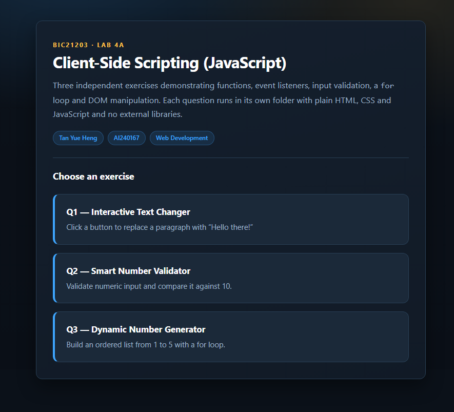
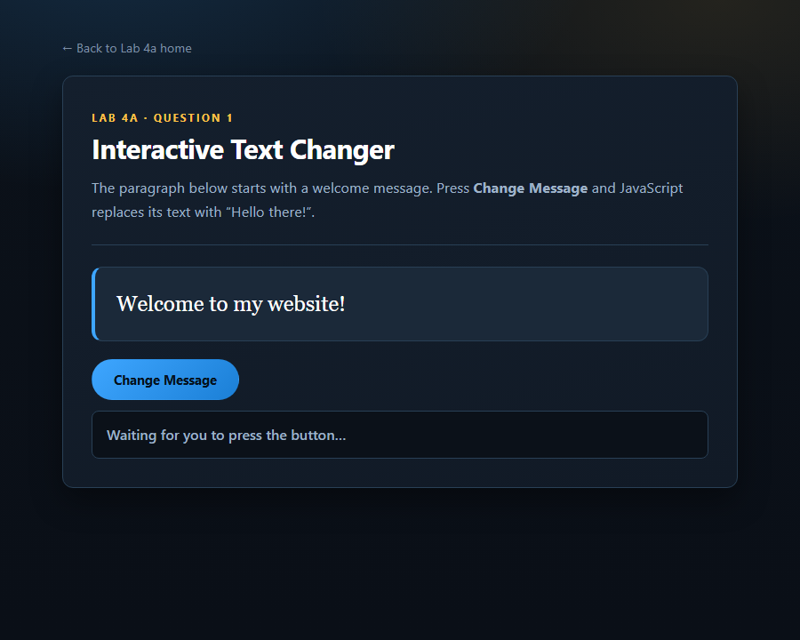
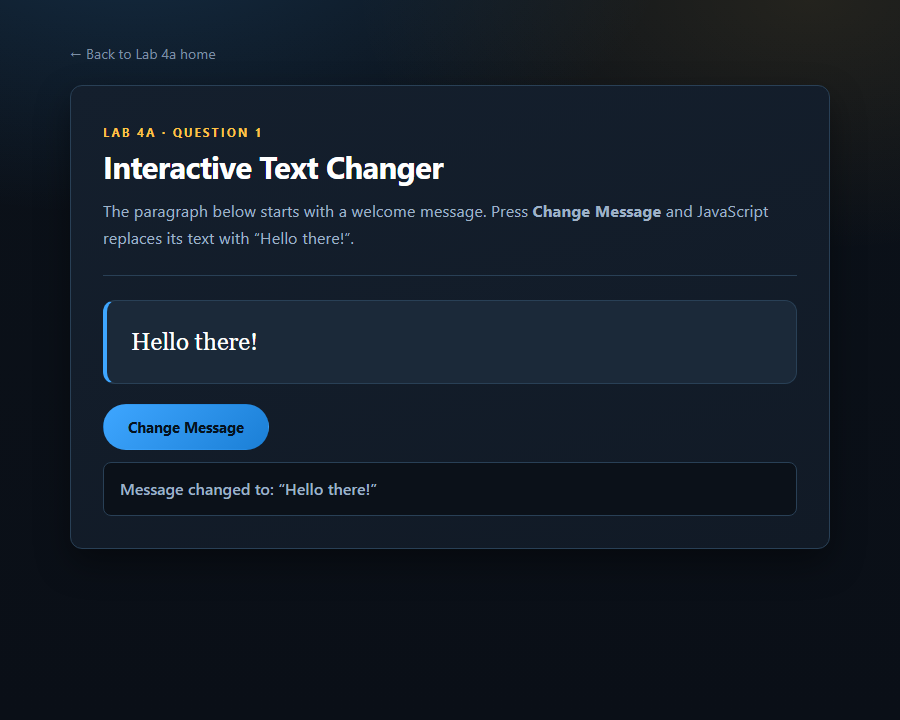
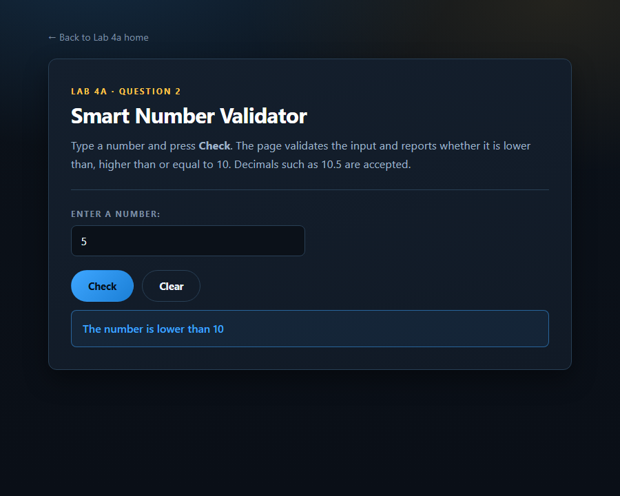
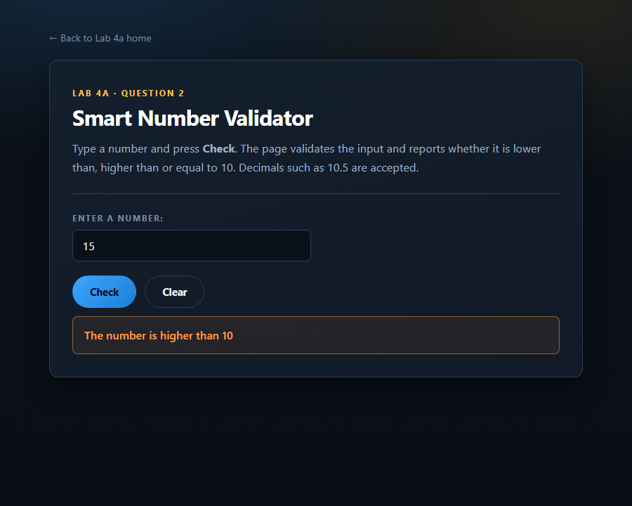
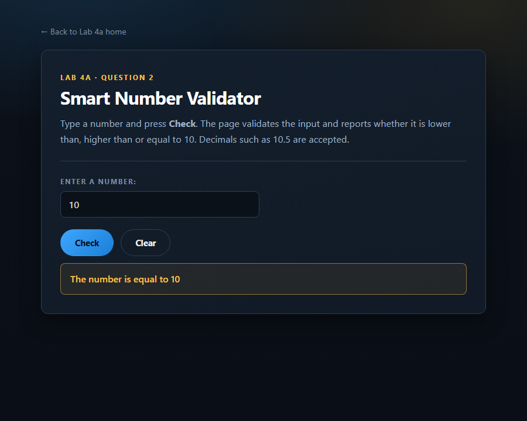
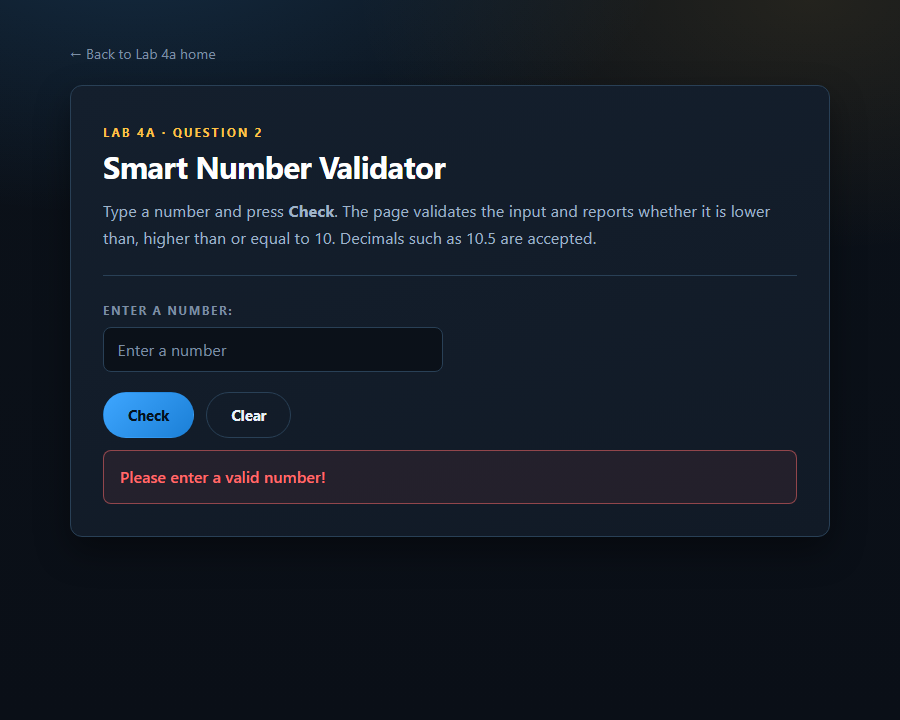
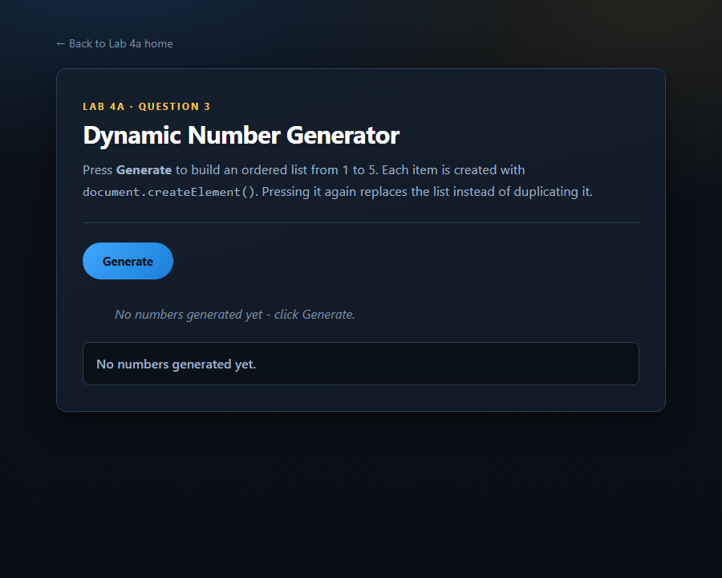
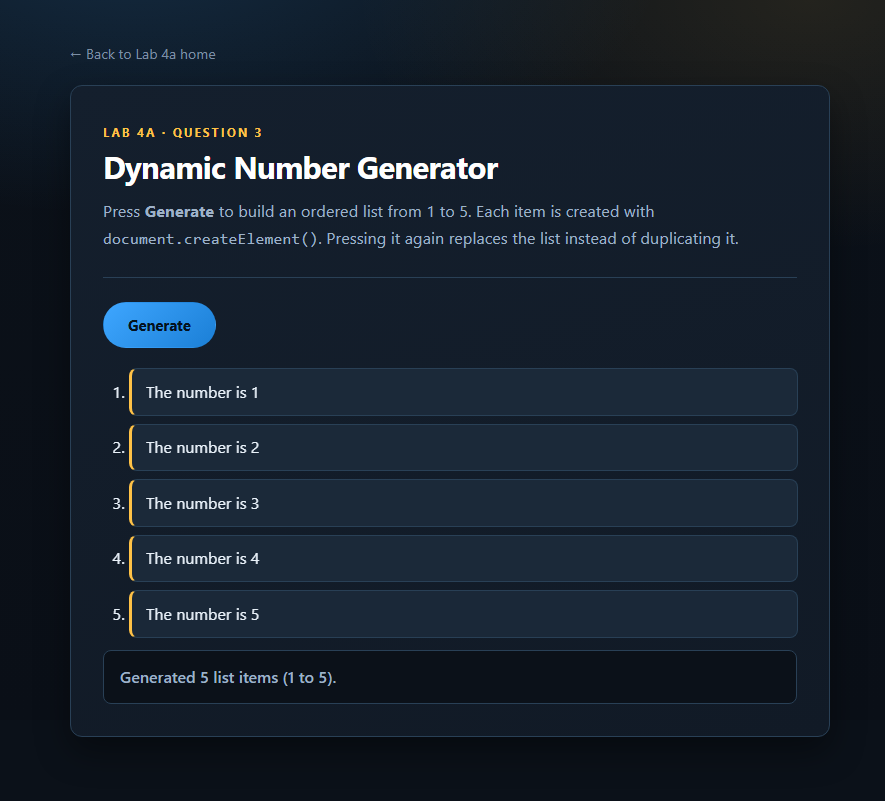

# BIC21203 — Lab 4a: Client-Side Scripting (JavaScript)

**Name:** TAN YUE HENG
**Matric No:** AI240167
**Course:** BIC21203 Web Development
**Lab:** 4a — Client-Side Scripting (JavaScript)

---

## About this repository

This repository contains my solutions to the three Lab 4a JavaScript exercises. Each
question is a self-contained webpage built with plain HTML5, CSS and modern
JavaScript. **No external libraries or frameworks are used** — everything runs
directly in a current desktop browser.

The exercises cover functions, event handling with `addEventListener()`, input
validation with `if … else if … else`, a `for` loop, and DOM manipulation using
`createElement()` / `textContent` / `appendChild()`.

## Repository structure

```
Lab4a/
├── index.html            Landing page linking the three exercises
├── shared/
│   └── style.css         One shared stylesheet for all pages
├── q1/
│   ├── index.html        Question 1 — Interactive Text Changer
│   └── q1.js
├── q2/
│   ├── index.html        Question 2 — Smart Number Validator
│   └── q2.js
├── q3/
│   ├── index.html        Question 3 — Dynamic Number Generator
│   └── q3.js
└── screenshots/          Browser output evidence for each question
```

## How to run

1. Clone or download this repository.
2. Open `index.html` in Chrome, Edge or Firefox.
3. Choose an exercise, or open any question folder directly.

> No build step, server or installation is required. The pages are opened
> straight from the file system.



---

## Question 1 — Interactive Text Changer

Opens with the message *"Welcome to my website!"*. Clicking **Change Message**
replaces it with *"Hello there!"*.

**How it works** (`q1/q1.js`):

1. The paragraph and button are selected with `document.getElementById()`.
2. `changeMessage()` sets `message.textContent = "Hello there!"`.
3. The function is attached with `changeBtn.addEventListener("click", changeMessage)`.

`textContent` is used instead of `innerHTML` so text is always inserted as plain
text. No inline `onclick` attributes are used.

**Expected result:** the paragraph shows *"Welcome to my website!"* on load, then
*"Hello there!"* after the button is pressed.

| Before clicking | After clicking **Change Message** |
|---|---|
|  |  |

---

## Question 2 — Smart Number Validator

Reads a number from the input and displays a validation message below it.

**How it works** (`q2/q2.js`):

`checkInput()` follows the required `if … else if … else` structure:

1. **Empty or whitespace-only** input → `"Please enter a valid number!"`.
   This is checked first because `Number("")` returns `0`, not `NaN`.
2. **Non-numeric** text (e.g. `abc`, `12px`) → `Number()` gives `NaN` →
   `"Please enter a valid number!"`.
3. **Below 10** → `"The number is lower than 10"`.
4. **Equal to 10** → `"The number is equal to 10"`.
5. **Otherwise** → `"The number is higher than 10"`.

The result is written to `#result` with `textContent` and announced through
`role="status"` / `aria-live="polite"`. The click is registered with
`addEventListener()`, and pressing Enter in the field also runs the check.

**Test cases verified in the browser:**

| Input | Output message | Screenshot |
|---|---|---|
| `5` | The number is lower than 10 | [view](screenshots/q2_lower.png) |
| `15` | The number is higher than 10 | [view](screenshots/q2_higher.png) |
| `10` | The number is equal to 10 | [view](screenshots/q2_equal.png) |
| `abc` | Please enter a valid number! | [view](screenshots/q2_invalid.png) |
| *(empty)* | Please enter a valid number! | [view](screenshots/q2_empty.png) |
| `10.5` | The number is higher than 10 | [view](screenshots/q2_decimal.png) |

Additional cases verified: `9.99` (lower), `-4` (lower), `0` (lower),
`12px` (invalid), and string of spaces (invalid).

| Lower than 10 | Higher than 10 |
|---|---|
|  |  |

| Equal to 10 | Invalid input (`abc`) |
|---|---|
|  |  |

| Empty input | Decimal `10.5` |
|---|---|
|  |  |

---

## Question 3 — Dynamic Number Generator

Clicking **Generate** builds an ordered list containing
*"The number is 1"* through *"The number is 5"*.

**How it works** (`q3/q3.js`):

1. `generateNumbers()` is attached with `addEventListener("click", …)`.
2. `numberList.replaceChildren()` clears any existing items first, so repeated
   clicks never duplicate the list.
3. A `for` loop runs `for (let i = 1; i <= 5; i++)`.
4. Each item is created with `document.createElement("li")`, its text set with
   `textContent`, and appended with `appendChild()`.

**Expected result:** an ordered list showing *"The number is 1"* through
*"The number is 5"*. Clicking **Generate** repeatedly keeps exactly five items
because the list is cleared first.

| Before clicking | After clicking **Generate** |
|---|---|
|  |  |

| After four clicks — still five items, no duplicates |
|---|
|  |

---

## Testing summary

All three exercises were verified in a current desktop browser:

- **Q1** — the paragraph changes to *"Hello there!"* on the first click and stays
  correct on repeated clicks.
- **Q2** — tested against 11 inputs including decimals, negatives, whitespace and
  invalid text (`abc`, `12px`); every case produced the required message.
- **Q3** — the button was pressed four times and the list stayed at exactly five
  items with no duplication.

The output screenshots for every question are included above.

## Accessibility practices applied

- Descriptive `<label>` elements tied to inputs with `for` / `id`.
- Meaningful button text instead of "Click here".
- Visible status regions (`role="status"`, `aria-live="polite"`) so results are
  announced to screen reader users.
- `:focus-visible` outlines for keyboard navigation.
- `prefers-reduced-motion` respected by all animations.
